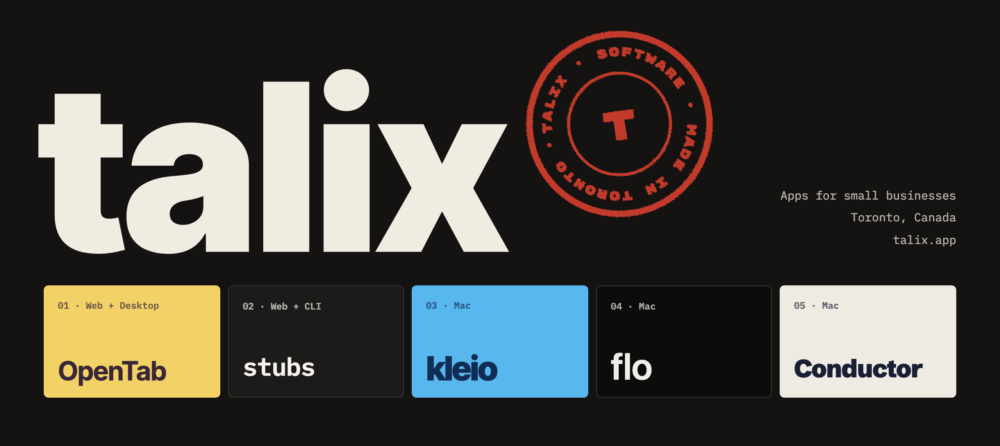

  

  <a href="https://talix.app">talix.app</a> ·
  <a href="https://opentab.talix.app">OpenTab</a> ·
  <a href="mailto:support@talix.app">support@talix.app</a>

Talix is a small software company in Toronto. We make a billing app for agencies and studios, a tool for sharing `.env` files, and three Mac apps for dictation, meeting notes and hands-free control.

## Apps

| App | What it does | Runs on | Get it |
| --- | --- | --- | --- |
| **[OpenTab](https://opentab.talix.app)** | Time tracking and invoicing for agencies and studios. Clients, timers, invoices and payments in one place, plus the OpenTab Timer desktop app. The Windows build isn't code-signed yet, so SmartScreen warns on install. | Web, macOS, Windows | [Open](https://opentab.talix.app) |
| **[Stubs](https://github.com/dev-talix/stubs)** | Paste a `.env` and get a link that opens once. Values are encrypted before they leave your machine, and agents can pull them into `.env.local` without reading them. | Web, CLI (Node) | [Website](https://stubs.talix.app) · [npm](https://www.npmjs.com/package/@talix/stubs) |
| **[Kleio](https://github.com/dev-talix/kleio)** | Records your mic and the call on separate tracks, then transcribes on your Mac. Rename speakers, search, take notes, export. No meeting bot. | macOS 15+, Apple silicon | [Website](https://kleio.talix.app) · [Download](https://github.com/dev-talix/kleio/releases/latest/download/Kleio.dmg) |
| **[Flo](https://github.com/dev-talix/flo)** | Hold a key, talk, let go. Flo transcribes on-device and pastes the text into whatever app has focus. | macOS 14+, Apple silicon | [Website](https://flo.talix.app) · [Download](https://github.com/dev-talix/flo/releases/latest) |
| **[Conductor](https://github.com/dev-talix/conductor)** | Webcam hand tracking for your Mac. Point to move, pinch to click and drag, make a fist to scroll, use both hands to zoom. | macOS 14+, camera | [Website](https://conductor.talix.app) · [Download](https://github.com/dev-talix/conductor/releases/latest/download/Conductor.zip) |

## Where your data goes

The Mac apps do their main work on your Mac. Kleio and Flo transcribe locally, and Conductor's camera frames never leave the machine. Each README lists what does go out:

- Kleio's summaries are optional. Cloud summaries send transcript text to the provider you pick.
- Conductor sends numerical hand-point diagnostics by default. You can turn them off in Settings.
- Flo downloads its speech model once, then works offline.
- Stubs never sees the decryption key. The server deletes its copy once the link is opened or it expires.

## Contact

Found a bug? Open an issue on the app's repo. For anything else, email [support@talix.app](mailto:support@talix.app).

Talix · Toronto, Canada
